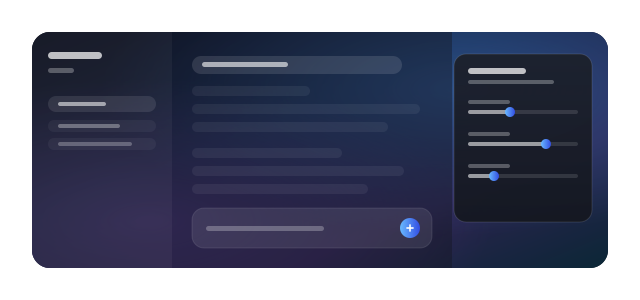

# Window wallpaper for DeepSeek Harness

A DSH Web GUI plugin that puts one background image behind the whole window — sidebar, conversation, and the in-frame title bar — and makes the shell panels translucent so the image shows through. Appearance is tuned in **Settings → General → Background image**.



## Features

- Full-window, fixed background layer that stays covered while the window resizes or the conversation scrolls.
- Two built-in gradients (a dark aurora and a light daylight scene) selected from the active color scheme; no image is required to see the effect.
- Choose a local JPG, PNG, WebP, GIF, or AVIF; large images are downscaled and re-encoded before they are stored.
- **Scrim** (0–80%) darkens the image behind text; a bright photo gets a stronger suggested scrim automatically until you move the slider.
- **Panel opacity** (10–80%) controls how much of the image shows through the shell; the sidebar is kept slightly more opaque than the conversation so its rows stay readable.
- **Background blur** (0–30 px, default 8 px) turns a detailed photo into a soft backdrop; set it to 0 for a crisp image.
- **Use default** resets the image, scrim, panel opacity, and blur.
- Light and dark palettes both keep their theme tokens for text, borders, menus, and controls.

## Install

From the source repository:

```sh
dsh plugin --profile web add github:ZttsZfts/dsh-window-wallpaper
```

After the npm package is published, the registry form is:

```sh
dsh plugin --profile web add dsh-window-wallpaper
```

Restart or refresh the Web GUI after installing. The plugin targets DSH `>=0.2.2-rc.5 <0.3.0`.

## Use

1. Open **Settings → General → Background image**.
2. Choose **Choose image** and pick a file. The preview on the same row shows the image with the current scrim and panel tint.
3. Adjust **Scrim**, **Panel opacity**, and **Background blur** until the text is comfortable.
4. **Use default** returns to the built-in gradient and resets all three sliders.

The image is stored in the current browser profile's `localStorage` (`dsh-wallpaper.v1`), compressed to fit. It never leaves the machine: the plugin makes no network request and sends no analytics. If browser storage is unavailable, the image still applies for the current session and the row reports that it may not survive a restart.

## Limitations

- The settings are per browser origin, not per DSH profile; another browser or a different GUI origin starts with the default gradient.
- Menus, dialogs, the terminal, and a few raised panels intentionally keep their own opaque fills for readability; the wallpaper is not visible through them.
- One still image at a time. Animated GIFs are decoded to a single frame when compressed.
- The plugin changes the Web GUI only; it does not touch the operating system desktop wallpaper.
- The image is not uploaded to the Host. A future Host-side store would be a separate design.

## Compatibility

- DSH `>=0.2.2-rc.5 <0.3.0`.
- The Client half uses only the baseline React module and the Client `slots`, `locale`, and `theme` services; it imports no DSH Client package.
- The Host half registers nothing; all rendering lives in the Client module.

## Development

The package is plain JavaScript with no build step:

```sh
node --check index.js
node --check client.js
```

The bundle is a `dsh.bundle` package: `cordis.patch.yml` inserts the `dsh-wallpaper` row and `package.json` points its Client half at `client.js`.

## License

[MIT](LICENSE). Copyright (c) 2026 ZttsZfts.

---

## 中文简介

为整个 Harness 窗口铺一张背景图：侧栏、会话区和窗口标题栏都会透出图片，同时把原本不透明的外壳面板改为半透明。打开 **设置 → 通用 → 背景图片** 选择本机图片，并用 **背景遮罩**、**面板浓度**、**背景模糊** 调整可读性；**恢复默认** 回到内置渐变并重置三项参数。

图片只保存在当前浏览器的 `localStorage`，不会上传，也不会联网；菜单、终端等面板保留自身的不透明底色。支持 DSH `>=0.2.2-rc.5 <0.3.0`，采用 MIT 许可。
